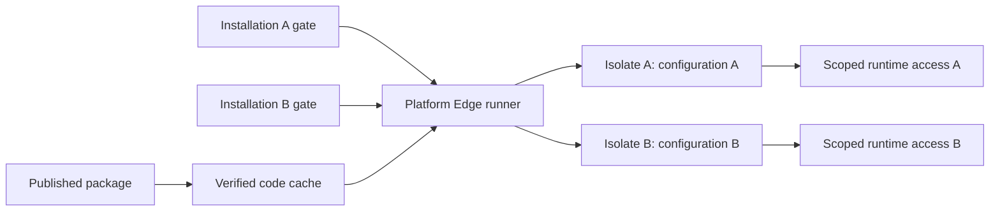

# Shared Fleet packages with isolated installations

Status: implemented for packages declaring `fleet_execution_protocol_version: 1`,
with PostgreSQL and local workerd integration coverage. Hosted availability
requires the coordinated rollout in [Managed application Fleets](../managed-fleets.md).
Existing packages retain their legacy execution path.

Publish an immutable package once. An installation selects that package and
supplies its own execution context. Publishing owns code preparation;
installation owns identity, configuration, data, admission and accounting.

Use a platform Edge runner with Cloudflare Worker Loader to instantiate the
published Edge bundle in a separate isolate for each installation. Reuse one
prepared Session runtime image, installing its bytes once per compute host and
attaching its Build identity to each authorized App. Existing per-App storage,
Sandboxes, policies and budgets remain the isolation boundaries on compute.

## Why the existing path needs to change

The [installation worker](../../console/core/fleets/worker.ts) passes the same
artifact pair to `ReleaseRepository.begin` for every installation. That method
queues both `deploy_api` and `materialize_build`. The API provider creates a
Cloudflare script named after each release, and the runtime worker invokes the
Docker-to-ext4 converter again. Prepared object storage already deduplicates
matching rootfs uploads, but this happens after conversion. Compute's
`prepared-builds` endpoint downloads another temporary copy even if the rootfs
is already installed.

Several contracts assume exclusive ownership of those deployments:

- [Activation](../../console/core/release-activation/worker.ts) requires the
  script name to equal the App release ID and writes current secrets to it.
- [Configuration](../../console/core/configuration/cloudflare-provider.ts)
  replaces bindings on that script.
- [Archival](../../console/core/compute-registrations/archive-worker.ts)
  removes the App's release scripts.

Sharing a script name without changing these contracts would allow one
installation to overwrite another's configuration or remove shared code.

## Objects and ownership

| Object | Owns | Cardinality |
| --- | --- | --- |
| Package | Edge bundle, prepared runtime manifest, Build ID, runtime ID, schema and execution contract | One per immutable published version |
| Installation | App ID, external key, selected/desired package, activation generation | One per customer installation |
| Configuration snapshot | Declared environment values and credentials at a specific revision | Per installation/revision |
| Edge execution context | Installation globals, bindings and scoped capabilities | Created on demand; may remain warm |
| Host image | Verified immutable rootfs and process contract | One per host/content identity |
| App Build attachment | Authorization to select a package's Build for an App | Per installation/package used |

Package identity includes the Edge digest, prepared manifest digest, runtime ID,
schema contract, SDK contract, compatibility date and flags. The materializer's
toolchain/guest contract also participates in any conversion-cache key.
Semver is a name for this immutable record, not a mutable code pointer.
Configuration values and credentials never participate in package contents.

Keep App IDs as the installation identity because compute, Workspaces, traces,
policies and budgets already use them. An App is no longer the owner of a code
deployment in this path. Fleet quota accounting continues to count one Fleet.

## Edge execution



The existing App release gate remains the authority for admission. Its selected
target becomes a tagged reference: a legacy script, or a package plus immutable
configuration reference and activation generation. Only the private control
path may select a target. Public hostnames still resolve to App IDs.

The platform runner reads the selected, validated references and obtains the
package bundle from content-addressed storage. Verify the digest on cache fill;
cache code independently of installation bindings. No Cloudflare script upload
or settings update is required to install an App.

Use a Worker Loader identity derived from:

```text
runner contract + App ID + package execution fingerprint
                + configuration revision + authorization generation
```

This keeps module globals and secrets separate between installations, even
when the bundle bytes are identical. It also starts a new context for a
configuration change or new authorization generation. The callback for a given
identity must always describe the same WorkerCode: fixed modules, compatibility
settings, bindings and installation-scoped egress capability. Persist immutable
configuration snapshots, or reject obsolete revisions; never read mutable
current values and silently populate an old identity with new bindings.

Cloudflare documents cached isolates and configuration-sensitive identities in
the [Worker Loader API](https://developers.cloudflare.com/dynamic-workers/api-reference/).
Warm reuse is opportunistic. Code storage and publication are shared; active
installations still consume separate isolate memory and can incur cold starts.

### Request identity and egress

Request IDs and request-lifetime service capabilities must stay out of cached
WorkerCode. Pass a fresh, installation-bound runtime capability through
`getEntrypoint(..., {props})` on each invocation. Its platform implementation
owns the App ID, activation generation and request ID. User-supplied HTTP
headers or method arguments cannot choose another installation. This invocation
option is present in the checked-in dependency's `WorkerStubEntrypointOptions`
and the [workerd interface](https://github.com/cloudflare/workerd/blob/main/src/workerd/api/worker-loader.h).

Keep a controlled `globalOutbound` gateway for other outbound fetches. Bind it
to installation identity and authorization generation, enforce the existing
public-destination restrictions, and deny direct private runtime access. Never
inherit the runner's unrestricted network access. Cloudflare supports
[controlled egress](https://developers.cloudflare.com/dynamic-workers/usage/egress-control/)
and [scoped service bindings](https://developers.cloudflare.com/dynamic-workers/usage/bindings/).
The child receives neither package storage access nor provider credentials.

The runner and runtime-capability service must fence obsolete generations,
including calls after configuration rotation, suspension or deletion. A warm
isolate is a cache, never evidence that admission is still authorized. Account
for outstanding streams and background work when closing admission; do not
treat receipt of response headers as proof that all activity has ended.

### SDK contract

The SDK currently emits a default fetch handler whose protocol implementation
uses global `fetch` for runtime access. It needs a declared Fleet execution
contract that accepts the invocation's runtime capability and threads it through
commands, webhook connections, event streams, file sync and terminal upgrades.
Use a request-local transport. Avoid mutable module globals and per-request
patches to global `fetch` or `process.env`.

The installation environment can retain its existing binding names and App
integration-token authentication inside its isolated context. This preserves
the public App client contract. The capability changes the private transport.
Application secrets declared for Edge handlers remain visible to that
installation's code; platform origin credentials remain behind the broker.

Existing bundles do not implement this new capability contract. Require a
rebuilt, explicitly compatible package for migration. Record compatibility in
the artifact manifest and validate it during publication.

## Publishing and installing

Publishing validates and stores the artifact pair, ensures one prepared runtime
manifest, then marks the package ready. Preparation is durable and idempotent,
with one fenced producer per content/toolchain key. Reuse an owned successful
source release's verified prepared-manifest receipt when available. Snapshot
artifact references only; source App credentials and configuration stay private.
Repairing a failed preparation retries this package operation once for all
waiting installations.

Publication currently takes an already deployed standalone source release.
Direct artifact publication (build → publish package → install) is a separate
API extension; the shared installation path does not depend on that extension.

An installation of a ready package performs these operations:

1. Reserve the external key and create its isolated App identity idempotently.
2. Register the managed App on compute with admission closed.
3. Authorize and attach the prepared package Build. Fetch the rootfs only if
   this host lacks a verified matching image.
4. Validate configuration and provision the installation's configuration
   snapshot, policy and budget.
5. Activate a generation that selects the matching package on Edge and compute,
   read both back, then open admission.

This path queues neither `deploy_api` nor Docker conversion per installation.
Per-App activation/history records can remain for API compatibility, but their
components refer to shared package assets. Replace assumptions that a component
script must equal its release ID with explicit target ownership and type.

## Compute image reuse

Separate ensuring a host has image bytes from attaching a Build to an App.
The existing content-addressed image catalog and per-App Build associations
provide much of this split already. Extend the private provider contract with
an authorized attach operation and a reusable host image receipt.

A Build digest alone grants no access: attachment must verify App ownership,
Fleet/package binding, package readiness and the expected installation intent.
Synchronize acquisition, attachment and collection so an image cannot disappear
between validation and selection. Validate an existing file against the pinned
receipt/manifest, repair corrupted cache entries, and download with full digest
verification on a miss. A host replacement naturally repopulates its cache.

Only immutable rootfs bytes are shared. Writable Sandbox state, Workspaces,
database credentials and environment remain installation-scoped. Image
collection must include package retention, App attachments, running/parked
Sandboxes and supported rollback targets among its roots.

## Upgrades, configuration and deletion

Keep selected and desired package IDs distinct. Prepare a new package once,
then move installations through the existing drain, schema migration and fenced
activation sequence in bounded batches. Canary, pause and pin an installation
without republishing code. A Fleet rollout records desired assignments;
changing a Fleet-wide default alone cannot atomically migrate every database
and compute selection.

Rollback selects a retained package with the installation's current
configuration, subject to schema compatibility. It never restores old secrets.
Configuration changes advance the snapshot revision and authorization
generation and project to Edge and compute without rebuilding package code.
Retiring a package prevents new assignments; suspending existing installations
is a separate explicit policy action.

Deleting an installation closes/fences its gate, drains or stops its compute,
purges its storage and removes its package attachments. It cannot delete shared
package code or images. Permanent external-key tombstones remain in force.

A future package collector must own shared artifact deletion. It may collect only after
checking active assignments, desired upgrades, rollback pins, operation leases
and in-flight execution references. Serialize attachment against the transition
to collecting; reject new references to that incarnation and retry ambiguous
provider cleanup safely. Shared assets must survive deletion of the old source
App and of any individual installation.

## Delivery sequence and acceptance

1. Introduce package preparation receipts, explicit deployment ownership and
   retention roots; reuse prepared runtime manifests.
2. Implement authorized Build attachment and host image reuse, with collection
   races covered by compute integration tests.
3. Add and publish the SDK Fleet transport contract and test every ingress and
   streaming path with the private capability transport.
4. Implement the private Edge runner and package gate target, immutable
   configuration projection, generation checks and per-App observability.
5. Add the installation activation path and change configuration, reconciliation,
   cancellation and archival to understand shared assets.
6. Rebuild a canary package, migrate installations through fenced activation,
   then retire their old scripts after acknowledgement and drain. Migrate
   remaining installations in bounded batches, retaining recoverable old
   assignments until the rollback window closes.

For a ready package and a warm host, installing 100 Apps must cause zero
Cloudflare script uploads, zero Docker conversions and zero rootfs downloads.
A new host needs one verified image acquisition per digest, coalescing concurrent
misses. There are still 100 identity, authorization and activation records.

Qualification must also prove overlapping requests cannot cross App bindings or
runtime capabilities; stale jobs cannot reopen admission; rotation fences old
capabilities; deletion during install/upgrade cannot resurrect an App or collect
live assets; source App archival preserves packages; rollback uses current
secrets; host loss and corrupt caches recover; and logs, WebSockets, streamed
responses and cancellation preserve App/request attribution. Account-level
Worker Loader availability and production behavior require a deployed canary;
local emulation alone is insufficient.

The implementation uses the existing authorized `prepared-builds` endpoint to
attach a package Build. Its durable pending-upload receipt fences image
collection, and its host install mutex coalesces misses. Verified local images
skip download and scratch-space admission. Corrupt regular cache files are
repaired; symlinks are rejected. The package's prepared manifest is reused,
so installations never invoke the Docker materializer. Shared package Edge code
is retained indefinitely, while App archival purges its private gate bindings.

Run the integrated Edge test with `bun run test:fleet-runtime` in `edge/workers`.
It bundles the actual dispatcher, gate and runner and checks isolation, forged
headers, rotation, immutable package publication, stale capabilities, streaming,
WebSocket upgrades and permanent gate retirement. It also verifies that
unsupported hosted native-terminal routes remain denied. The PostgreSQL test
is `console/core/fleets/shared-packages.integration.test.mjs`.

## Local runtime experiment

Run [the disposable-design probe](../../tests/experiments/fleet-code-sharing.mjs)
with the dependencies already installed under `edge/workers`:

```sh
node tests/experiments/fleet-code-sharing.mjs
```

The probe uses real local workerd through Miniflare. Forty overlapping
invocations of the same module across two installation identities retained
separate globals and secrets. Every call received its own runtime capability,
forged headers could not override its identity, unrestricted fetch was blocked,
and a configuration rotation followed by package upgrade/rollback retained the
current configuration.

The fixture supplies identities directly and blocks all general egress. It
validates the runtime primitive, not production authentication, admission,
storage, the current SDK, Fire Fuse integration or deployed Cloudflare behavior.
